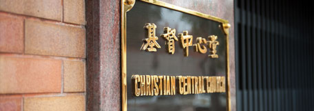
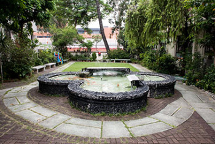

# CCCKT Website Revamp

Rebuilding the [基督中心堂 (CCCKT)](https://ccckt.org.hk) church website — moving off an outdated, unpatched WordPress install onto a free-tier static site with a managed database.

**Live at: [ccckt.pages.dev](https://ccckt.pages.dev)**

## Status

Most of the rebuild is live. Volunteers can log in and post content today; the public site reflects it immediately.

- ✅ Astro site scaffolded and deployed to Cloudflare Pages
- ✅ Supabase project set up — database, auth, and file storage
- ✅ Admin login + volunteer forms (announcement, sermon, event), tested end to end
- ✅ Public pages live, with real content migrated from the old site
- ✅ Visual design pass (typography, color, layout)
- ⬜ Patch the live WordPress site (interim security mitigation — independent of this rebuild, still outstanding)
- ⬜ Confirm the final volunteer list with church leadership
- ⬜ DNS cutover and WordPress decommission

## Architecture

| Service | Role |
| --- | --- |
| **Astro** (`site/`) | Builds the public pages and the volunteer admin forms into static HTML/CSS/JS — no server runs at request time |
| **Cloudflare Pages** | Hosts the static site on a free global CDN; auto-deploys on every push to `main` |
| **Supabase** (`supabase/`) | Postgres database (announcements/sermons/events), volunteer login (Auth, invite-only), and file storage for sermon uploads |

The browser talks directly to Supabase for login and content — there's no backend server in between. See `CCCKT Website Architecture.pptx` for the full diagrammed explanation, including how a volunteer updates content and how to add a new admin account.

## Repo layout

| Path | Description |
| --- | --- |
| `site/` | The Astro project — public pages and `/admin` volunteer forms |
| `supabase/` | Database migrations and project config, linked to the hosted Supabase project |
| `images/` | Reference photos pulled from the live ccckt.org.hk site, used in this README and for the site's own imagery |
| `CCCKT Website Revamp — Design Document.{md,docx,pdf}` | Full design doc: problem statement, architecture, content model, phased plan, costs, open risks |
| `ccckt_revamp.pptx` | Original 15-slide stakeholder-review deck |
| `CCCKT Website Architecture.pptx` | Technical deep-dive deck: the three services, how they connect, content-update flow, adding admins |

## Open items

See the design document's "Open Risks & Items Needing Confirmation" section — WordPress admin access, DNS contact, and the volunteer list all still need confirmation from church leadership before the final cutover.
